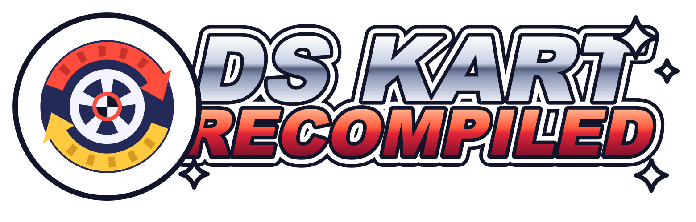

<b>English</b> · <a href="#español">Español</a>

# DS Kart Recompiled

**A native PC port of the European Mario Kart DS, made by static recompilation — no emulator.**

> 🚧 **Work in progress.** The code and a ready-to-play launcher will be published here when the project is
> finished. Star or watch the repository to know when it's out.

## What it is

Instead of emulating a Nintendo DS, the game's own code (for both of the DS processors, the ARM9 and the ARM7)
is translated into C and compiled into a normal Windows program. Around it, a small "runtime" does the job of the
console: memory, interrupts, timers, the 2D and 3D graphics engines, sound, saving and controls.

Because it runs natively, it can go beyond the original:

- **3D at 2×, 3× or 4× resolution** — menus and HUD stay pixel-perfect like on the DS
- **Up to 240 fps** — in-between 3D frames are generated while the game logic stays at 60
- **Full screen with both screens side by side**
- **PS5, PS4 and Xbox controllers**, and your **PC microphone** for Balloon Battle
- **Instant replays** — F10 saves the last 30 seconds as a video
- **Its own launcher** in English, Spanish, French, German and Italian
- **Everything unlocked** from the start

## What you will need

- Windows
- A dump of **your own** European *Mario Kart DS* cartridge (game code `AMCP`).
  **The game is not and will never be included here.**

## Planned

- Local multiplayer over the internet (for example with Radmin VPN)
- Online play through community servers

## Credits

- Made by **alontube** — [alontube.pages.dev](https://alontube.pages.dev)
- Inspired by [WiiCompiled](https://github.com/patchzyy/wiicompiled), the Mario Kart Wii recompilation.
  It doesn't use its code: the idea of translating the game instead of emulating it comes from there.

## Disclaimer

Fan project **not affiliated with Nintendo**. *Mario Kart* and *Nintendo DS* are trademarks of Nintendo.

---

# DS Kart Recompiled (Español)

**Port nativo para PC de Mario Kart DS (versión europea) hecho por recompilación estática: sin emulador.**

> 🚧 **En desarrollo.** El código y un launcher listo para jugar se publicarán aquí cuando el proyecto esté
> terminado. Dale a la estrella o a "Watch" para enterarte cuando salga.

## Qué es

En vez de emular una Nintendo DS, el propio código del juego (el de los dos procesadores de la DS, el ARM9 y el
ARM7) se traduce a C y se compila como un programa normal de Windows. Alrededor, un pequeño "runtime" hace de
consola: memoria, interrupciones, temporizadores, los motores de gráficos 2D y 3D, el sonido, el guardado y los
controles.

Como funciona de forma nativa, puede ir más allá del original:

- **3D a 2×, 3× o 4× de resolución**: los menús y el marcador se ven como en la DS, sin difuminar
- **Hasta 240 imágenes por segundo**: se inventan imágenes intermedias del 3D mientras el juego sigue a 60
- **Pantalla completa con las dos pantallas lado a lado**
- **Mandos de PS5, PS4 y Xbox**, y el **micrófono del PC** para la Batalla de globos
- **Repeticiones instantáneas**: F10 guarda los últimos 30 segundos en vídeo
- **Launcher propio** en español, inglés, francés, alemán e italiano
- **Todo desbloqueado** de serie

## Qué hará falta

- Windows
- Una copia de **tu propio cartucho** de *Mario Kart DS* europeo (código `AMCP`).
  **El juego no está ni estará nunca aquí.**

## Planeado

- Multijugador local por internet (por ejemplo con Radmin VPN)
- Juego en línea con servidores de la comunidad

## Créditos

- Hecho por **alontube**: [alontube.pages.dev](https://alontube.pages.dev)
- Inspirado en [WiiCompiled](https://github.com/patchzyy/wiicompiled), la recompilación de Mario Kart Wii.
  No usa su código: la idea de traducir el juego en vez de emularlo viene de ahí.

## Aviso

Proyecto de aficionado **sin relación con Nintendo**. *Mario Kart* y *Nintendo DS* son marcas de Nintendo.
